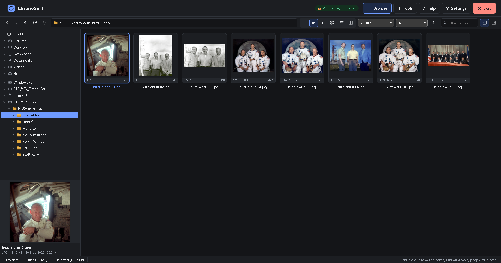
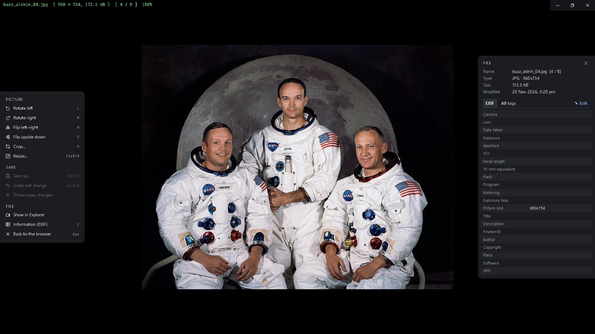

# ChronoSort

Private, local sorter that puts photos and videos into **year folders**, with safety as the first priority. Your photos and videos never leave your PC.

- **Never damages originals.** Copy mode by default. Every copy is hash-verified, timestamps are preserved, nothing is ever overwritten, and every action is logged so it can be undone.
- **Explains each date.** EXIF, video metadata, sidecars (XMP, Google Takeout), filenames and folders are weighed against each other and checked for conflicts.
- **Asks when unsure.** A thumbnail review page lets you confirm or correct the year, and batch-confirm whole boxes of scans.
- **Find duplicates.** Identical copies with a large preview of each, so you choose which one to keep.
- **People.** Name the people in your photos; ChronoSort learns their faces (OpenCV YuNet + SFace) on this PC only.
- **Ask the AI.** For photos without a reliable date, a local vision model (Qwen3-VL via llama.cpp) reads printed date stamps and guesses the era. It is only a suggestion and never accepted without you.
- **Add a place.** Write a town or country (GPS + place name) into many photos at once, from a built-in offline list of places, with undo.
- **Portable mode.** Run ChronoSort from a USB stick and take your models and named people with it.
- **No online AI.** The internet is used only if you click Download for a model or engine, and every download is checked by SHA-256.
- Windows first, then Linux and macOS.

- **Browse, view and tidy up.** ChronoSort opens in a built-in file browser with thumbnails, a full-screen viewer, simple edits (turn, flip, crop, resize; JPEG turns are lossless), photo information you can edit, and safe file housekeeping with Undo.




<sub>Screenshot photos: public-domain NASA images, see [credits](docs/screenshots/browser/CREDITS.md).</sub>

Experimental software: **use at your own risk**, and keep a backup of your photos.

License: **GPL-3.0-or-later**. Anyone sharing ChronoSort or a modified version must keep it open.

## Status
Working on Windows: analysis, review, planning, verified copy/move, undo, crash recovery, duplicates, people, AI date suggestions, places, portable mode. Linux and macOS are compile-checked only so far.
See [docs/ROADMAP.md](docs/ROADMAP.md), [docs/ARCHITECTURE.md](docs/ARCHITECTURE.md), and the screenshots in [docs/screenshots](docs/screenshots).

## Building
`scripts/env.sh` expects a portable toolchain in a `tools` folder beside the project folder: `tools/rust` (rustup + cargo, windows-gnu), `tools/mingw64` (w64devkit) and `tools/node`. With a normal Rust + Node install you can skip it.
```bash
. scripts/env.sh                                  # Git Bash   (PowerShell: . .\scripts\env.ps1)
bash scripts/check.sh                             # fmt + clippy + tests + Linux/macOS check + audit
(cd apps/chronosort-app && npm install && npm run build)                  # UI
cargo build --release -p chronosort-app --features chronosort-app/custom-protocol   # ChronoSort.exe
cargo build --release -p chronosort                                       # chronosort-cli.exe
```
Release files go to `dist/` (ChronoSort.exe + WebView2Loader.dll, chronosort-cli.exe, and the `exiftool/` folder, which "Add a place" needs next to the program).

## Command line
```bash
chronosort-cli plan  SRC DEST [--months keep|flatten] [--rename keep|datetime|TEMPLATE]   # dry run
chronosort-cli run   SRC DEST [--move] [--threads N] [-y]                                   # copy + verify
chronosort-cli undo  DEST [--run N]
chronosort-cli analyze SRC [-v] [--json report.json]
chronosort-cli testgen OUT  /  eval CORPUS                                                  # test corpus
```

## Layout
| Path | What |
|---|---|
| `crates/cs-platform` | the only OS-specific code: file times (incl. creation), no-replace rename, free space, long paths, dir sync |
| `crates/cs-model` | shared types: evidence, decisions, reports, calendar helpers |
| `crates/cs-scan` | walk (no symlinks/junctions), content sniffing, junk, grouping (RAW+JPG, sidecars) |
| `crates/cs-meta` | EXIF, MP4/MOV, XMP, Takeout, file/folder name dates, damage checks |
| `crates/cs-date` | evidence weights, sanity rules, decisions with plain-language reasons |
| `crates/cs-core` | parallel analysis pipeline, BLAKE3 hashes, duplicate detection |
| `crates/cs-plan` | year folders, month question, naming, clash numbering, de-duplication, destination pre-scan |
| `crates/cs-exec` | verified copy/move, journal, recovery, undo |
| `crates/cs-thumb` | safe thumbnails (decode limits, EXIF orientation), content-addressed cache |
| `crates/cs-db` | SQLite catalog + crash-safe journal |
| `crates/cs-faces` | face finding + fingerprints (YuNet + SFace ONNX), grouping, people |
| `crates/cs-ai` | hardware tiers, model catalogue, verified resumable downloads |
| `crates/cs-vision` | local llama-server sidecar (loopback, random key) for date suggestions |
| `crates/cs-geo` | offline place list, GPS + place names via ExifTool, backups + undo |
| `crates/cs-testgen` | synthetic edge-case corpus + evaluator |
| `apps/chronosort-cli` | command line (`chronosort-cli`) |
| `apps/chronosort-app` | desktop app: Tauri 2 (Rust) + Svelte 5 UI |
| `third_party/` | review notes for every reused project |
